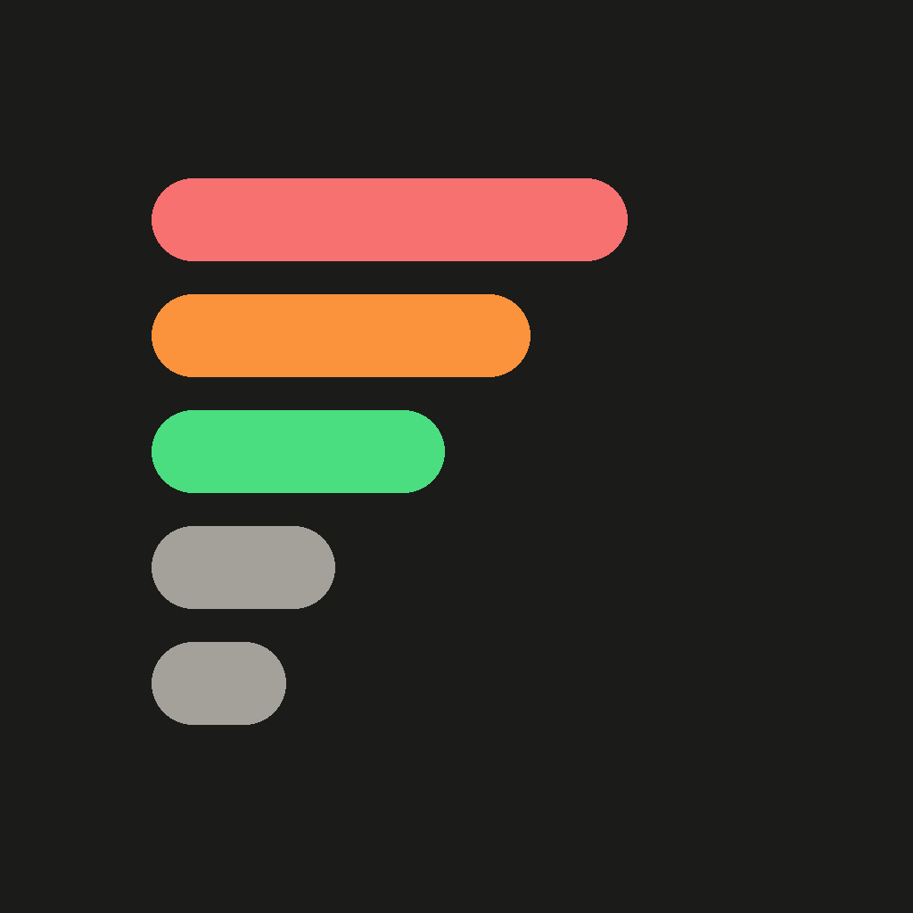
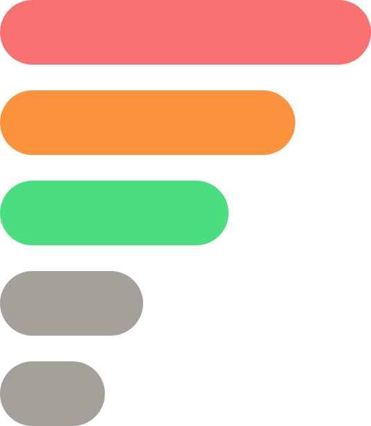

<p align="center"></p>

# Sift brand

How Sift looks and sounds, everywhere it shows up: the plugin icon, the README, the inbox, the local server pages and the terminal output. If you change something here, change it in [every place listed at the end](#where-the-brand-lives).

## Name

- **Sift**, capital S, in prose and titles. Never "SIFT" or "Sift.ai".
- `sift` in lower case only where it is code: commands (`/sift:triage`), paths (`sift/<owner>__<repo>/`), plugin ids (`sift@sift`).
- **Tagline:** Sift the signal from the noise in big GitHub repos.
- **One-liner:** A signal-vs-noise triage inbox for GitHub issues and PRs, for Claude Code.

## The mark



Five rounded bars, longest at the top. They are the inbox's lanes in order of attention: **urgent, wanted, review, then noise**. Sifting leaves less at each step.

| File | Use |
|---|---|
| [`brand/mark.svg`](brand/mark.svg) | The mark alone, transparent background. README, docs, slides. |
| [`brand/icon.svg`](brand/icon.svg) | The mark on Ink, 1024 × 1024. Vector source of the plugin icon. |
| [`.claude-plugin/icon.png`](.claude-plugin/icon.png) | The plugin icon shown by Claude Code. Rendered from `icon.svg`. |

**Geometry** (on the 1024 icon): bars are 93 tall with a 37 gap (a 130 pitch), fully rounded ends, left-aligned at x = 170 from y = 200. Lengths are 534, 425, 329, 206 and 151. In the icon the mark sits left of centre on purpose: the empty space on the right is the noise that was sifted out.

**Clear space:** at least one bar height on every side. **Smallest size:** 16 px tall (the favicon). Below that, don't use the mark.

**Don't:** recolour the bars, reorder them, centre-align them, add a gradient or shadow, put the mark on a busy image, or use the bars as a decorative stripe. The colours mean something (see below).

## Colour

### Brand colours

These are the mark's colours. In the product they carry **meaning**, never decoration: each one is a lane.

| Swatch | Name | Hex | Means |
|---|---|---|---|
|  | Signal red | `#f87171` | Urgent: severe, active, unanswered |
|  | Demand orange | `#fb923c` | Most wanted |
|  | Review green | `#4ade80` | PRs to review, ready, done |
|  | Noise stone | `#a3a19a` | Noise, low priority, secondary text |
|  | Ink | `#1b1b1a` | Icon background, dark surfaces, light-mode text |

**Action indigo** (`#8e8cff` on dark, `#5552e8` on light) is the one interface colour that isn't in the mark. It marks what you can do and what Claude says: the selected view, primary buttons, focus rings, "Claude's read". It never means a lane.

### Interface tokens

The inbox (`skills/triage/assets/viewer.html`) defines these as CSS custom properties. Dark is the default. Each theme has its own palette, not an inversion: lane colours get darker on light so text stays at 4.5:1 or better.

| Token | Dark | Light | Role |
|---|---|---|---|
| `--bg` | `#131312` | `#f6f5f2` | Page |
| `--surface` | `#1b1b1a` | `#ffffff` | Panes, cards |
| `--surface-2` | `#222220` | `#faf9f7` | Raised: rows, inputs |
| `--surface-3` | `#2b2a28` | `#efeee9` | Chips, pressed |
| `--text` | `#ecebe6` | `#1b1b1a` | Body text |
| `--muted` | `#a3a19a` | `#57554f` | Secondary text |
| `--faint` | `#8b8982` | `#6c6963` | Meta, captions |
| `--accent` | `#8e8cff` | `#5552e8` | Action indigo |
| `--urgent` | `#f87171` | `#c42323` | Signal red |
| `--wanted` | `#fb923c` | `#c2410c` | Demand orange |
| `--review` | `#4ade80` | `#15803d` | Review green |
| `--noise` | `#a3a19a` | `#6b6963` | Noise stone |
| `--info` | `#7dc4f2` | `#1f68b8` | Neutral information |

Each lane colour also has a `-soft` tint (about 12% opacity on dark) for chip and card backgrounds. Colour is never the only signal: every coloured chip or score also has a word or an icon.

## Type

- **Sans:** `Inter, "SF Pro Text", system-ui, -apple-system, "Segoe UI", Roboto, sans-serif`. No web fonts are loaded: the inbox is one offline file.
- **Mono:** `ui-monospace, "SF Mono", "JetBrains Mono", Menlo, Consolas, monospace`, for numbers, issue numbers, commands and paths. Numbers that get compared use tabular figures.
- **Scale:** 11 (uppercase section labels, tracked +0.09em) · 12.5 (meta) · 14 (body) · 16 (lead) · 21–24 (titles). Weights 400, 500, 600 and 650–700 for titles.
- **Headings** are sentence case: "Issues that need you", not "Issues That Need You".

## Icons

- One line set on a 24 × 24 grid, 1.75 stroke, round caps and joins, `currentColor`. They live in the `ICONS` table in `viewer.html`.
- Every view has its own icon (alert for Urgent, pull request for PRs, flame for Most wanted…). Reuse them; don't mix in another set.
- No emoji as icons in the interface. Icon-only buttons always get an accessible name and a tooltip.

## Voice

Sift talks like a calm maintainer who has read the whole backlog.

- **Plain and decisive.** "Close as duplicate of #1234", not "you might want to consider closing".
- **Numbers over adjectives.** "Waited 29 days, 4 people", not "has been waiting a long time".
- **Say what happens.** Buttons name the result: "Queue 3 as dup of #12", "Review 5 queued".
- **Safety stated, not shouted.** Repeat the one promise where it matters: nothing changes on GitHub until you confirm.
- **Sentence case, no exclamation marks, no hype** ("blazing", "magic", "AI-powered").
- Claude's verdicts are labelled **Claude's read**. Issue text is the public's, and the product treats it as data.

## Terminal output

Script output is for Claude and for people skimming a log. Every line starts with an UPPERCASE label padded to 10 columns, then the message:

```
SCORED    4766 items in 633 ms  ·  7 maintainers recognised
ISSUES    attention 30  ·  watch 676  ·  backlog 3201  ·  noise 59
NEXT      node <skill>/scripts/build.mjs storytold/photocraft
```

- `·` separates facts on one line. Counts come first.
- End with a `NEXT` line when there is an obvious next step, and `PROBLEMS` when something needs fixing.
- No colour codes or emoji: the output must read the same in any terminal and in a transcript.

## Where the brand lives

Keep these in sync when the brand changes:

| Place | What |
|---|---|
| [`brand/`](brand/) | Mark and icon sources (SVG) |
| [`.claude-plugin/icon.png`](.claude-plugin/icon.png) | Plugin icon |
| [`README.md`](README.md) | Logo, name, tagline |
| [`.claude-plugin/plugin.json`](.claude-plugin/plugin.json), [`marketplace.json`](.claude-plugin/marketplace.json) | Name and description |
| [`skills/triage/assets/viewer.html`](skills/triage/assets/viewer.html) | Inbox: logo, favicon, tokens, icons |
| [`skills/triage/scripts/serve.mjs`](skills/triage/scripts/serve.mjs) | Local server's report index page |
| `skills/triage/scripts/*.mjs` | Terminal output labels |
